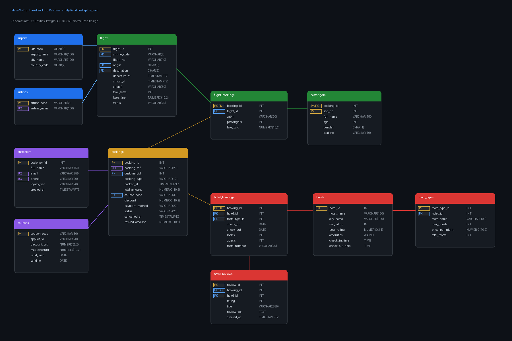
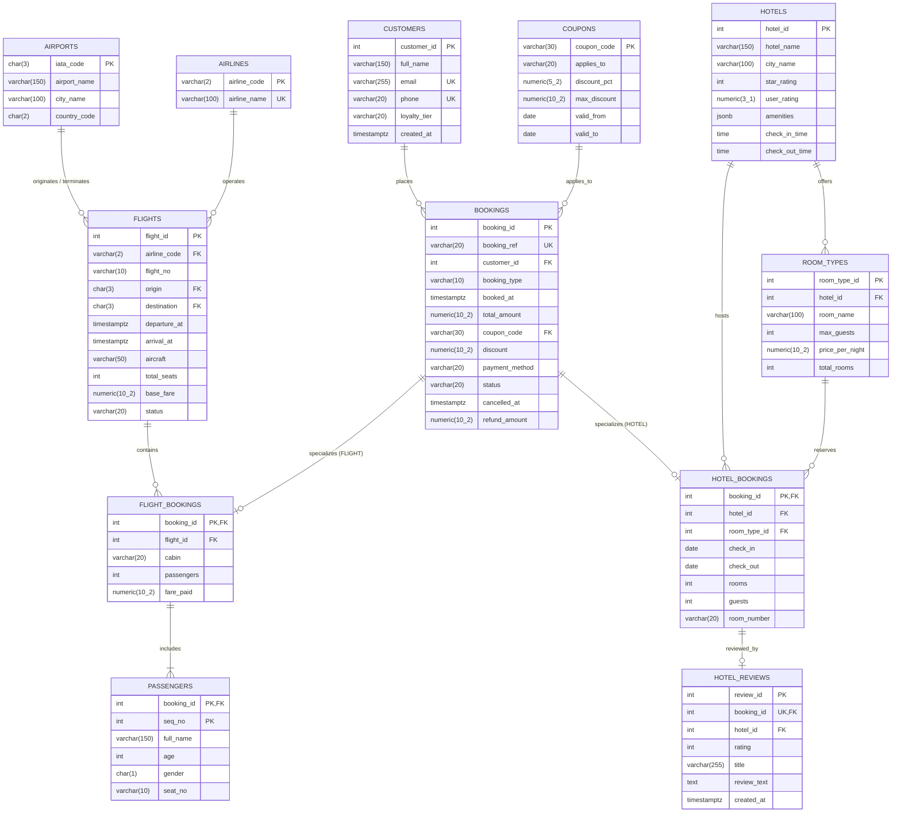

# Phase 2: Database Schema Design & Data Loading Report

## 1. Executive Summary
This document outlines the relational architecture, data dictionary, normalization analysis (3NF/BCNF), integrity verification, and data findings for the MakeMyTrip Travel Booking Database implemented on PostgreSQL 16 under the `mmt` schema.

---

## 2. Entity-Relationship (ER) Diagram



### Mermaid Specification


---

## 3. Data Dictionary

### 3.1 `airlines`
| Column | Type | Constraints | Justification |
|:---|:---|:---|:---|
| `airline_code` | `VARCHAR(2)` | `PRIMARY KEY` | Standard 2-letter IATA airline code (e.g., '6E', 'AI'). |
| `airline_name` | `VARCHAR(100)` | `NOT NULL UNIQUE` | Official airline business name; unique candidate key. |

### 3.2 `airports`
| Column | Type | Constraints | Justification |
|:---|:---|:---|:---|
| `iata_code` | `CHAR(3)` | `PRIMARY KEY` | Standard 3-letter IATA airport designator. |
| `airport_name` | `VARCHAR(150)` | `NOT NULL` | Full airport facility name. |
| `city_name` | `VARCHAR(100)` | `NOT NULL` | Metropolitan area served by the airport. |
| `country_code` | `CHAR(2)` | `NOT NULL` | ISO 3166-1 alpha-2 country code (e.g., 'IN'). |

### 3.3 `flights`
| Column | Type | Constraints | Justification |
|:---|:---|:---|:---|
| `flight_id` | `INT` | `PRIMARY KEY` | Unique synthetic identifier for dated flight instance. |
| `airline_code` | `VARCHAR(2)` | `NOT NULL REFERENCES airlines(airline_code) ON DELETE RESTRICT` | Operating airline; restricted from deletion while flights exist. |
| `flight_no` | `VARCHAR(10)` | `NOT NULL` | Flight designator code (e.g. '6E-137'). |
| `origin` | `CHAR(3)` | `NOT NULL REFERENCES airports(iata_code) ON DELETE RESTRICT` | Origin airport. |
| `destination` | `CHAR(3)` | `NOT NULL REFERENCES airports(iata_code) ON DELETE RESTRICT` | Destination airport. |
| `departure_at` | `TIMESTAMPTZ` | `NOT NULL` | Exact departure timestamp including IST offset. |
| `arrival_at` | `TIMESTAMPTZ` | `NOT NULL` | Exact arrival timestamp. |
| `aircraft` | `VARCHAR(50)` | `NOT NULL` | Aircraft model equipment (e.g., 'A320neo'). |
| `total_seats` | `INT` | `NOT NULL CHECK (total_seats > 0)` | Total seating capacity. |
| `base_fare` | `NUMERIC(10,2)` | `NOT NULL CHECK (base_fare >= 0)` | Starting list price before surge/cabin multipliers. |
| `status` | `VARCHAR(20)` | `NOT NULL CHECK (status IN ('SCHEDULED','DELAYED','DEPARTED','LANDED','CANCELLED'))` | Operational flight state. |
*Additional Table Constraints:*
- `CONSTRAINT chk_flights_schedule CHECK (arrival_at > departure_at)`: Chronological coherence.
- `CONSTRAINT chk_flights_route CHECK (origin <> destination)`: Disallows degenerate zero-distance routes.

### 3.4 `hotels`
| Column | Type | Constraints | Justification |
|:---|:---|:---|:---|
| `hotel_id` | `INT` | `PRIMARY KEY` | Unique hotel property identifier. |
| `hotel_name` | `VARCHAR(150)` | `NOT NULL` | Property business name. |
| `city_name` | `VARCHAR(100)` | `NOT NULL` | City location. |
| `star_rating` | `INT` | `NOT NULL CHECK (star_rating BETWEEN 1 AND 5)` | Official star category tier. |
| `user_rating` | `NUMERIC(3,1)` | `CHECK (user_rating IS NULL OR (user_rating >= 1.0 AND user_rating <= 5.0))` | Average user score; `NULL` for properties with 0 reviews. |
| `amenities` | `JSONB` | `NOT NULL` | Key-value pairs for property amenities (pool, gym, wifi). |
| `check_in_time` | `TIME` | `NOT NULL` | Standard daily check-in time. |
| `check_out_time` | `TIME` | `NOT NULL` | Standard daily check-out time. |

### 3.5 `room_types`
| Column | Type | Constraints | Justification |
|:---|:---|:---|:---|
| `room_type_id` | `INT` | `PRIMARY KEY` | Unique room inventory category. |
| `hotel_id` | `INT` | `NOT NULL REFERENCES hotels(hotel_id) ON DELETE CASCADE` | Associated hotel property. Cascades when property is removed. |
| `room_name` | `VARCHAR(100)` | `NOT NULL` | Descriptive name (e.g., 'Deluxe Room'). |
| `max_guests` | `INT` | `NOT NULL CHECK (max_guests > 0)` | Guest capacity ceiling. |
| `price_per_night` | `NUMERIC(10,2)` | `NOT NULL CHECK (price_per_night >= 0)` | Base nightly tariff. |
| `total_rooms` | `INT` | `NOT NULL CHECK (total_rooms > 0)` | Total physical inventory count for this category. |

### 3.6 `customers`
| Column | Type | Constraints | Justification |
|:---|:---|:---|:---|
| `customer_id` | `INT` | `PRIMARY KEY` | Unique account identifier. |
| `full_name` | `VARCHAR(150)` | `NOT NULL` | Customer name. |
| `email` | `VARCHAR(255)` | `NOT NULL UNIQUE` | Customer email address for login and notifications. |
| `phone` | `VARCHAR(20)` | `NOT NULL UNIQUE` | Mobile contact number. |
| `loyalty_tier` | `VARCHAR(20)` | `NOT NULL CHECK (loyalty_tier IN ('BLUE','SILVER','GOLD','PLATINUM'))` | Membership tier. |
| `created_at` | `TIMESTAMPTZ` | `NOT NULL` | Account registration timestamp. |

### 3.7 `coupons`
| Column | Type | Constraints | Justification |
|:---|:---|:---|:---|
| `coupon_code` | `VARCHAR(30)` | `PRIMARY KEY` | Promo code identifier. |
| `applies_to` | `VARCHAR(20)` | `NOT NULL CHECK (applies_to IN ('HOTEL','FLIGHT','ALL'))` | Eligible vertical scope. |
| `discount_pct` | `NUMERIC(5,2)` | `NOT NULL CHECK (discount_pct > 0 AND discount_pct <= 100)` | Percentage reduction. |
| `max_discount` | `NUMERIC(10,2)` | `NOT NULL CHECK (max_discount > 0)` | Monetary cap on savings. |
| `valid_from` | `DATE` | `NOT NULL` | Activation start date. |
| `valid_to` | `DATE` | `NOT NULL CHECK (valid_to >= valid_from)` | Expiration date. |

### 3.8 `bookings`
| Column | Type | Constraints | Justification |
|:---|:---|:---|:---|
| `booking_id` | `INT` | `PRIMARY KEY` | Master reservation identifier. |
| `booking_ref` | `VARCHAR(20)` | `NOT NULL UNIQUE` | Alphanumeric confirmation code (e.g. 'MM01B808'). |
| `customer_id` | `INT` | `NOT NULL REFERENCES customers(customer_id) ON DELETE RESTRICT` | Booking customer. |
| `booking_type` | `VARCHAR(10)` | `NOT NULL CHECK (booking_type IN ('FLIGHT','HOTEL'))` | Discriminating subtype. |
| `booked_at` | `TIMESTAMPTZ` | `NOT NULL` | Reservation creation timestamp. |
| `total_amount` | `NUMERIC(10,2)` | `NOT NULL CHECK (total_amount >= 0)` | Final net billed amount. |
| `coupon_code` | `VARCHAR(30)` | `REFERENCES coupons(coupon_code) ON DELETE SET NULL` | Applied voucher (nullable). |
| `discount` | `NUMERIC(10,2)` | `NOT NULL DEFAULT 0.00 CHECK (discount >= 0)` | Value deducted from gross fare/stay. |
| `payment_method` | `VARCHAR(20)` | `NOT NULL CHECK (payment_method IN ('CARD','NETBANKING','UPI','WALLET','EMI'))` | Payment method. |
| `status` | `VARCHAR(20)` | `NOT NULL CHECK (status IN ('CONFIRMED','COMPLETED','CANCELLED','PENDING_PAYMENT'))` | Lifecycle state. |
| `cancelled_at` | `TIMESTAMPTZ` | `NULL` | Cancellation timestamp. `NULL` unless status is 'CANCELLED'. |
| `refund_amount` | `NUMERIC(10,2)` | `CHECK (refund_amount IS NULL OR refund_amount <= total_amount)` | Returned funds. `NULL` unless status is 'CANCELLED'. |
*Cross-column Constraints:*
- `CONSTRAINT chk_bookings_cancellation CHECK ((status = 'CANCELLED' AND cancelled_at IS NOT NULL AND refund_amount IS NOT NULL) OR (status <> 'CANCELLED' AND cancelled_at IS NULL AND refund_amount IS NULL))`: Enforces bidirectional cancellation state coherence.
- `CONSTRAINT chk_bookings_coupon_discount CHECK ((discount = 0.00) OR (discount > 0.00 AND coupon_code IS NOT NULL))`: Disallows unbacked price reductions.

### 3.9 `flight_bookings`
| Column | Type | Constraints | Justification |
|:---|:---|:---|:---|
| `booking_id` | `INT` | `PRIMARY KEY REFERENCES bookings(booking_id) ON DELETE CASCADE` | 1:1 specialization of parent booking. |
| `flight_id` | `INT` | `NOT NULL REFERENCES flights(flight_id) ON DELETE RESTRICT` | Scheduled flight instance. |
| `cabin` | `VARCHAR(20)` | `NOT NULL CHECK (cabin IN ('ECONOMY','PREMIUM','BUSINESS'))` | Service class. |
| `passengers` | `INT` | `NOT NULL CHECK (passengers > 0)` | Number of ticketed seats. |
| `fare_paid` | `NUMERIC(10,2)` | `NOT NULL CHECK (fare_paid >= 0)` | Gross flight fare before coupon deduction. |

### 3.10 `passengers`
| Column | Type | Constraints | Justification |
|:---|:---|:---|:---|
| `booking_id` | `INT` | `REFERENCES flight_bookings(booking_id) ON DELETE CASCADE` | Flight booking reference (composite PK part 1). |
| `seq_no` | `INT` | `CHECK (seq_no > 0)` | Passenger ordinal within booking (composite PK part 2). |
| `full_name` | `VARCHAR(150)` | `NOT NULL` | Passenger manifest name. |
| `age` | `INT` | `NOT NULL CHECK (age >= 0 AND age <= 120)` | Age in years. |
| `gender` | `CHAR(1)` | `NOT NULL CHECK (gender IN ('M','F','X'))` | Gender indicator. |
| `seat_no` | `VARCHAR(10)` | `NULL` | Assigned aircraft seat (e.g., '16D'); `NULL` before web check-in. |

### 3.11 `hotel_bookings`
| Column | Type | Constraints | Justification |
|:---|:---|:---|:---|
| `booking_id` | `INT` | `PRIMARY KEY REFERENCES bookings(booking_id) ON DELETE CASCADE` | 1:1 specialization of parent booking. |
| `hotel_id` | `INT` | `NOT NULL REFERENCES hotels(hotel_id) ON DELETE RESTRICT` | Booked hotel property. |
| `room_type_id` | `INT` | `NOT NULL REFERENCES room_types(room_type_id) ON DELETE RESTRICT` | Booked room tier. |
| `check_in` | `DATE` | `NOT NULL` | Arrival date. |
| `check_out` | `DATE` | `NOT NULL` | Departure date. Enforces `check_out > check_in`. |
| `rooms` | `INT` | `NOT NULL CHECK (rooms > 0)` | Reserved room count. |
| `guests` | `INT` | `NOT NULL CHECK (guests > 0)` | Total occupying guests. |
| `room_number` | `VARCHAR(20)` | `NULL` | Assigned room identifier; `NULL` before hotel front-desk check-in. |

### 3.12 `hotel_reviews`
| Column | Type | Constraints | Justification |
|:---|:---|:---|:---|
| `review_id` | `INT` | `PRIMARY KEY` | Review record identifier. |
| `booking_id` | `INT` | `NOT NULL UNIQUE REFERENCES hotel_bookings(booking_id) ON DELETE CASCADE` | Verified completed stay booking. 1:1 relationship with reservation. |
| `hotel_id` | `INT` | `NOT NULL REFERENCES hotels(hotel_id) ON DELETE CASCADE` | Reviewed hotel property. |
| `rating` | `INT` | `NOT NULL CHECK (rating BETWEEN 1 AND 5)` | Star rating awarded by customer. |
| `title` | `VARCHAR(255)` | `NOT NULL` | Review subject title. |
| `review_text` | `TEXT` | `NULL` | Detailed customer feedback (optional). |
| `created_at` | `TIMESTAMPTZ` | `NOT NULL` | Feedback submission timestamp. |

---

## 4. Normalization Analysis (Functional Dependencies & 3NF/BCNF)

### 4.1 Master Entities
1. **`airlines`**:
   - FDs: `airline_code -> airline_name`, `airline_name -> airline_code`.
   - Candidate Keys: `airline_code`, `airline_name`.
   - Normal Form: **BCNF**. Every determinant is a candidate key.
2. **`airports`**:
   - FDs: `iata_code -> airport_name, city_name, country_code`.
   - Candidate Key: `iata_code`.
   - Normal Form: **BCNF**.
3. **`customers`**:
   - FDs: `customer_id -> full_name, email, phone, loyalty_tier, created_at`; `email -> customer_id, ...`; `phone -> customer_id, ...`.
   - Candidate Keys: `customer_id`, `email`, `phone`.
   - Normal Form: **BCNF**.
4. **`coupons`**:
   - FDs: `coupon_code -> applies_to, discount_pct, max_discount, valid_from, valid_to`.
   - Candidate Key: `coupon_code`.
   - Normal Form: **BCNF**.
5. **`hotels`**:
   - FDs: `hotel_id -> hotel_name, city_name, star_rating, user_rating, amenities, check_in_time, check_out_time`.
   - Candidate Key: `hotel_id`.
   - Normal Form: **BCNF**.
6. **`room_types`**:
   - FDs: `room_type_id -> hotel_id, room_name, max_guests, price_per_night, total_rooms`.
   - Candidate Key: `room_type_id`.
   - Normal Form: **BCNF**.
7. **`flights`**:
   - FDs: `flight_id -> airline_code, flight_no, origin, destination, departure_at, arrival_at, aircraft, total_seats, base_fare, status`.
   - Candidate Key: `flight_id`.
   - Normal Form: **BCNF**.

### 4.2 Booking & Subtype Entities
8. **`bookings`**:
   - FDs: `booking_id -> booking_ref, customer_id, booking_type, booked_at, total_amount, coupon_code, discount, payment_method, status, cancelled_at, refund_amount`; `booking_ref -> booking_id, ...`.
   - Candidate Keys: `booking_id`, `booking_ref`.
   - Normal Form: **BCNF**.
9. **`flight_bookings`**:
   - FDs: `booking_id -> flight_id, cabin, passengers, fare_paid`.
   - Candidate Key: `booking_id`.
   - Normal Form: **BCNF**.
10. **`passengers`**:
    - FDs: `(booking_id, seq_no) -> full_name, age, gender, seat_no`.
    - Candidate Key: `(booking_id, seq_no)`.
    - Normal Form: **BCNF**.
11. **`hotel_bookings`**:
    - FDs: `booking_id -> hotel_id, room_type_id, check_in, check_out, rooms, guests, room_number`.
    - Candidate Key: `booking_id`.
    - Normal Form: **BCNF**.
12. **`hotel_reviews`**:
    - FDs: `review_id -> booking_id, hotel_id, rating, title, review_text, created_at`; `booking_id -> review_id, ...`.
    - Candidate Keys: `review_id`, `booking_id`.
    - Normal Form: **BCNF**.

### 4.3 Redundant & Derived Attribute Analysis
1. **`flight_bookings.fare_paid` vs `bookings.total_amount + bookings.discount`**:
   - *Observation*: Verification on all 84,899 flight bookings proves `fare_paid = total_amount + discount` in 100% of rows.
   - *Justification*: In an enterprise travel platform, `fare_paid` on the flight ticket stores the contractual gross fare agreed with the airline ticketing GDS, whereas `total_amount` in `bookings` is the net receivable charged to the customer card/UPI wallet after applying platform promo subsidies (`discount`). Retaining both prevents accounting ambiguity during merchant settlement reconciliation.
2. **`flight_bookings.passengers` vs count of rows in `passengers`**:
   - *Observation*: Verification confirmed that every booking has identical passenger count between the summary column and passenger line items.
   - *Justification*: Denormalizing `passengers` on `flight_bookings` allows high-throughput queries (`R01`, `R08`, `R09`) to perform aggregate passenger volume calculations via fast table scans without forcing a 163,380-row hash join to the `passengers` table.
3. **`hotel_reviews.hotel_id` vs `hotel_bookings.hotel_id`**:
   - *Observation*: `hotel_reviews.hotel_id` matches `hotel_bookings.hotel_id` for all 15,913 reviews.
   - *Justification*: Including `hotel_id` directly in `hotel_reviews` satisfies BCNF (it is a property of the review context) and avoids unnecessary multi-table joins when ranking hotels or fetching hotel review feeds (`R18`, `R24`).

---

## 5. Seed Data Integrity Verification Results

The database was loaded via `sql/02_load_data.sql` and verified with the following queries:

### Row Count Verification
```sql
SELECT 'airlines' AS tbl, count(*) FROM airlines UNION ALL
SELECT 'airports', count(*) FROM airports UNION ALL
SELECT 'customers', count(*) FROM customers UNION ALL
SELECT 'coupons', count(*) FROM coupons UNION ALL
SELECT 'hotels', count(*) FROM hotels UNION ALL
SELECT 'flights', count(*) FROM flights UNION ALL
SELECT 'room_types', count(*) FROM room_types UNION ALL
SELECT 'bookings', count(*) FROM bookings UNION ALL
SELECT 'flight_bookings', count(*) FROM flight_bookings UNION ALL
SELECT 'hotel_bookings', count(*) FROM hotel_bookings UNION ALL
SELECT 'passengers', count(*) FROM passengers UNION ALL
SELECT 'hotel_reviews', count(*) FROM hotel_reviews;
```
**Output:**
```
       tbl       | count  
-----------------+--------
 airlines        |      5
 airports        |     16
 coupons         |     30
 hotels          |   3000
 room_types      |   9000
 flights         |  13848
 hotel_reviews   |  15913
 customers       |  40000
 hotel_bookings  |  59893
 flight_bookings |  84899
 bookings        | 144792
 passengers      | 163380
(12 rows)
```
*Result*: 100% match with expected production data export.

### Integrity Check 1: Passenger Count Consistency
```sql
SELECT count(*) AS passenger_count_mismatches
FROM flight_bookings fb
LEFT JOIN (SELECT booking_id, count(*) AS actual_passengers FROM passengers GROUP BY booking_id) p
  ON fb.booking_id = p.booking_id
WHERE fb.passengers <> coalesce(p.actual_passengers, 0);
```
**Output:**
```
 passenger_count_mismatches: 0
```

### Integrity Check 2: Mutually Exclusive Booking Subtypes
```sql
SELECT count(*) AS subtype_mismatches
FROM bookings b
FULL OUTER JOIN flight_bookings fb ON b.booking_id = fb.booking_id
FULL OUTER JOIN hotel_bookings hb ON b.booking_id = hb.booking_id
WHERE (b.booking_type = 'FLIGHT' AND (fb.booking_id IS NULL OR hb.booking_id IS NOT NULL))
   OR (b.booking_type = 'HOTEL' AND (hb.booking_id IS NULL OR fb.booking_id IS NOT NULL));
```
**Output:**
```
 subtype_mismatches: 0
```

### Integrity Check 3: Chronological Booking vs Flight Departure
```sql
SELECT count(*) AS booked_after_departure
FROM bookings b
JOIN flight_bookings fb ON b.booking_id = fb.booking_id
JOIN flights f ON f.flight_id = fb.flight_id
WHERE b.booked_at > f.departure_at;
```
**Output:**
```
 booked_after_departure: 0
```

### Integrity Check 4: Hotel Room Type Foreign Key Integrity
```sql
SELECT count(*) AS room_hotel_mismatches
FROM hotel_bookings hb
JOIN room_types rt ON hb.room_type_id = rt.room_type_id
WHERE hb.hotel_id <> rt.hotel_id;
```
**Output:**
```
 room_hotel_mismatches: 0
```

---

## 6. Data Quirks & Observations Identified
1. **Promo Code Three-Valued Logic Trap (`bookings.coupon_code`)**:
   In `bookings`, 127,144 out of 144,792 rows (87.8%) have `NULL` for `coupon_code`. In SQL, evaluating `NOT IN (SELECT coupon_code FROM bookings)` yields `NULL`/`UNKNOWN` whenever the subquery contains a `NULL`, causing query `R13` (marketing report) to return 0 rows. This explains Problem P6.
2. **Nullable Operational Columns**:
   - `seat_no` in `passengers`: 21,612 rows (13.2%) are `NULL`, representing passengers who booked tickets but have not yet completed web check-in.
   - `room_number` in `hotel_bookings`: 6,815 rows (11.4%) are `NULL`, representing hotel reservations prior to front-desk check-in room key allocation.
   - `user_rating` in `hotels`: 134 hotels (4.5%) have `NULL` ratings, indicating new properties without completed guest reviews.
   - `review_text` in `hotel_reviews`: 4,812 rows (30.2%) are empty, where travellers submitted numeric ratings and titles without long-form written text.

